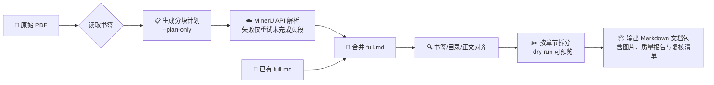

<div align="center">

# 📚 MinerU Textbook to Markdown

**面向 Agent 的结构化 PDF / 教材转 Markdown Skill**  
将长篇教材与结构化 PDF 转换为保留图文、按章节有序拆分、附带质量报告与人工复核清单的 Markdown 文档包。

[](CHANGELOG.md)
[](pyproject.toml)
[](LICENSE)
[](https://github.com/ber-ners/mineru-textbook-to-md)

[核心特性](#-核心特性) · [工作流程](#-工作流程) · [快速开始](#-快速开始) · [参数说明](#-常用参数) · [输出结构](#-输出结构) · [安全与合规](#-文件安全与合规) · [开发指南](#-开发指南)

</div>

> [!NOTE]
> 本仓库的核心入口是 [`SKILL.md`](SKILL.md)，底层 Python 代码作为 Skill 的内置运行资源提供。  
> 当前版本为 `0.1.1`（Alpha），正式处理重要文档前，建议先使用 `--plan-only` 和 `--dry-run` 预览分块与拆分边界。

---

## ✨ 核心特性

| 特性 | 说明 |
| :--- | :--- |
| 📑 **书签智能分块** | 优先依据 PDF 书签规划 MinerU 上传边界，避免在固定页数处机械切断章节。 |
| 🔁 **断点复用重试** | MinerU 任务临时失败后自动复用已完成的分块结果，仅重试未完成页段。 |
| 🗂️ **多级结构对齐** | 对齐 PDF 书签、目录与正文标题，支持 `篇 / 部 / 编 / 卷 / 单元 / 章 / 节` 等多级结构。 |
| 🖼️ **精准图文打包** | 生成带稳定数字前缀的篇/章目录，并仅复制当前章节实际引用的图片资源。 |
| 📊 **可复核质量报告** | 自动输出章节映射、拆分预览、解析质量总报告与待人工复核清单，方便逐章抽检。 |
| ⚡ **支持离线拆分** | 可直接基于已有的 `full.md` 进行章节拆分与重组，无需重复上传 PDF。 |
| 🛡️ **非破坏式管理** | 默认保护原始 PDF 与未知用户文件，所有覆盖或重建操作均需显式确认。 |

---

## 🧭 工作流程



---

## 🚀 快速开始

### 1. 安装 Skill

将整个仓库放入 Agent 的 Skill 目录，例如：

```text
$CODEX_HOME/skills/mineru-textbook-to-md/
```

也可以从 [GitHub Releases](https://github.com/ber-ners/mineru-textbook-to-md/releases) 下载 `mineru-textbook-to-md-skill-v*.zip` 并解压到上述目录。

### 2. 安装依赖

运行时要求 **Python 3.10+**，首次使用前安装运行依赖：

```bash
python -m pip install -r "<skill-root>/requirements.txt"
```

### 3. 配置 MinerU Token

<details>
<summary><b>展开查看不同终端的配置方式</b></summary>

**macOS / Linux (bash / zsh)**

```bash
export MINERU_OFFICIAL_API_TOKEN="sk-..."
```

**Windows (PowerShell)**

```powershell
$env:MINERU_OFFICIAL_API_TOKEN = "sk-..."
# 若终端出现中文乱码，可同时启用 UTF-8：
$env:PYTHONUTF8 = "1"
```

> [!WARNING]
> 请勿将 API Token 写入仓库文件、命令示例或输出目录中。

</details>

### 4. 运行转换

通过 Skill 自带入口 [`scripts/run.py`](scripts/run.py) 运行，不依赖固定路径：

**① 生成上传分块计划（推荐先预览）**

```bash
python "<skill-root>/scripts/run.py" --pdf /path/to/book.pdf --plan-only
```

**② 确认计划后执行解析与拆分**

```bash
python "<skill-root>/scripts/run.py" --pdf /path/to/book.pdf --split-by auto
```

**③ 直接拆分已有的 `full.md`（先预览边界）**

```bash
python "<skill-root>/scripts/run.py" \
  --from-full-md /path/to/full.md \
  --page-count 500 \
  --dry-run
```

---

## ⚙️ 常用参数

| 参数 | 说明 |
| :--- | :--- |
| `--output DIR` | 指定输出文档包的父目录 |
| `--base-name NAME` | 指定生成的书名根目录名称 |
| `--split-by VALUE` | 指定拆分粒度：`auto`、`part`、`chapter` 或 `section` |
| `--plan-only` | 仅生成 MinerU 上传分块计划，不实际上传 |
| `--dry-run` | 仅预览章节拆分边界，不写入章节文件 |
| `--archive-output` | 写入新结果前，先归档旧章节目录与质量报告 |
| `--force` | 显式替换冲突的 PDF / `full.md` 副本，并重建 MinerU 缓存 |
| `--direct-download` | 仅在下载 MinerU 结果时绕过系统代理 |

执行 `python "<skill-root>/scripts/run.py" --help` 可查看完整参数列表。

---

## 📂 输出结构

默认在源 PDF 同级目录下创建一个以书名命名的文档包目录：

```text
<PDF 所在目录>/
└── <书名>/
    ├── <原始 PDF>.pdf
    ├── full.md                         # 合并后的完整 Markdown
    ├── 00-MinerU分块计划.json          # 上传分块边界计划
    ├── 00-MinerU原始分块/              # MinerU 原始返回分块缓存
    ├── 00-PDF书签分级目录.md           # 有可用书签时生成
    ├── 00-章节拆分预览.md              # 章节边界与对齐预览
    ├── 00-章节映射.json                # 结构化章节映射数据
    ├── 00-解析质量总报告.md            # 全书解析统计与质量概览
    ├── 00-待人工复核.md                # 需重点检查的章节与问题清单
    ├── images/                         # 全书图片资源池
    └── 02-第二篇 .../
        └── 01-第一章 .../
            ├── 01-原文解析.md          # 当前章节正文
            ├── 02-解析质量报告.md      # 当前章节质量详情
            └── images/                 # 仅包含本章实际引用的图片
```

> [!TIP]
> 没有可用篇级书签的章节会归入 `99-未归类章节/`；工具不会为了目录结构外观而创建没有正文的空章节。

---

## 🛡️ 文件安全与合规

- **保护现有文件**：`--force` 仅清理工具自身管理的 MinerU 缓存并显式替换冲突的源副本，绝不会删除未知用户文件。
- **冲突拦截**：外部 `full.md` 或同名 PDF 与目标内容不一致时，默认中止操作并提示确认。
- **ZIP 解压防护**：严格限制解压路径、文件数量、单文件体积与总展开大小，防止 Zip Slip / Zip Bomb。
- **图片引用校验**：Markdown 中的绝对路径与越界图片引用不会被复制到章节目录。
- **代理策略**：默认遵循系统代理设置，仅在显式传入 `--direct-download` 时绕过代理下载结果。
- **数据与版权**：运行 PDF 工作流会将文档上传至 MinerU 服务。请仅处理您有权上传和转换的文档，切勿上传患者信息、个人隐私、机密材料或受监管数据；本工具仅提供格式转换能力，不授予任何文档内容的复制或分发权利。

---

## 🛠️ 开发指南

普通 Skill 使用者只需安装 `requirements.txt`；如需参与开发、测试或打包，可安装开发依赖：

```bash
python -m pip install -e ".[dev]"
python -m unittest discover -s tests -v
python -m ruff check mineru_textbook_to_md tests
python -m build
python -m twine check dist/*
```

更多项目文档：
- 贡献指南：[CONTRIBUTING.md](CONTRIBUTING.md)
- 安全策略：[SECURITY.md](SECURITY.md)
- 更新日志：[CHANGELOG.md](CHANGELOG.md)
- 开源协议：[LICENSE](LICENSE)（MIT License）
