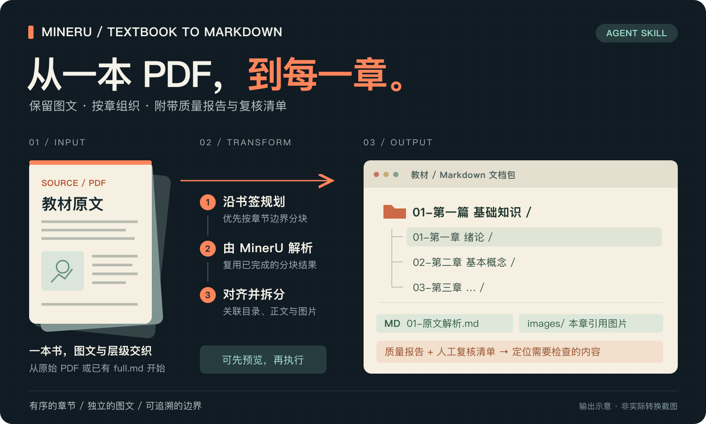
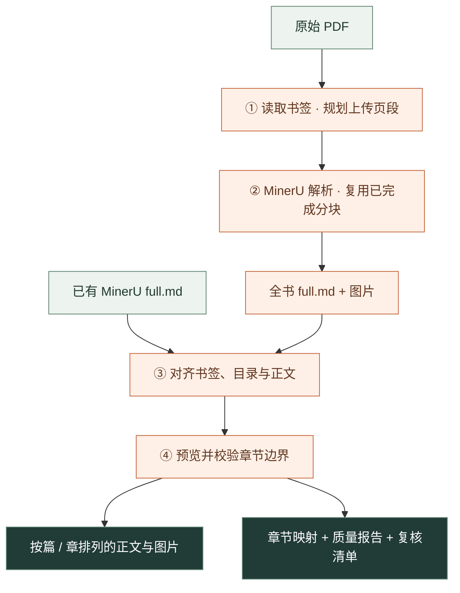

<div align="center">



# MinerU Textbook to Markdown

**把整本教材，整理成可以逐章阅读、引用与复核的 Markdown 文档包。**

面向 Agent 的 PDF / 教材转换 Skill · 支持已有 MinerU `full.md` 离线拆分

[](CHANGELOG.md)
[](pyproject.toml)
[](LICENSE)
[](https://github.com/ber-ners/mineru-textbook-to-md)

[看输出](#output) · [交给 Agent](#agent) · [快速开始](#quickstart) · [工作原理](#workflow) · [参数速查](#options)

</div>

<a id="output"></a>

## 一本书进来，一套有序文档出去

原始 PDF 中的篇、章、正文与配图，转换后各有位置。下面是**输出结构示例**，实际目录随原书结构生成：

```text
教材.pdf
   │
   ▼
教材/
├── 教材.pdf                            原始文件副本
├── full.md                             全书 Markdown
│
├── 01-第一篇 基础知识/
│   ├── 01-第一章 绪论/
│   │   ├── 01-原文解析.md              打开这一章，直接读正文
│   │   ├── images/                     本章实际引用的配图
│   │   └── 02-解析质量报告.md          查看这一章的解析情况
│   └── 02-第二章 基本概念/
│       └── …
│
├── 00-章节拆分预览.md                  检查“从哪里切开”
├── 00-章节映射.json                    追溯目录与正文的对应关系
├── 00-解析质量总报告.md                查看全书解析概况
└── 00-待人工复核.md                    定位需要人工检查的内容
```

| 你想做什么 | 转换后从哪里开始 |
| :--- | :--- |
| **逐章阅读与引用** | 进入按数字排序的篇 / 章目录，打开 `01-原文解析.md`。 |
| **单独整理某一章** | 章节目录包含正文和本章引用的图片，便于一起整理。 |
| **检查转换是否可靠** | 先看全书质量报告，再沿复核清单查看章节边界与图片问题。 |

<details>
<summary><b>查看完整产物：分块计划、原始缓存与图片资源</b></summary>

```text
教材/
├── 教材.pdf
├── full.md
├── images/                             全书图片资源池
├── 00-MinerU分块计划.json              PDF 工作流的上传分块计划
├── 00-MinerU原始分块/                  原始解析结果，可用于失败后复用
├── 00-PDF书签分级目录.md               有可用 PDF 书签时生成
├── 00-章节拆分预览.md
├── 00-章节映射.json
├── 00-解析质量总报告.md
├── 00-待人工复核.md
└── 01-第一篇 基础知识/
    └── 01-第一章 绪论/
        ├── 01-原文解析.md
        ├── 02-解析质量报告.md
        └── images/
```

默认在源 PDF 同级目录下创建书名文件夹。没有可用篇级书签的章节归入 `99-未归类章节/`；不会为了填满目录而创建没有正文的空章节。使用已有 `full.md` 拆分时，产物取决于已有输入，不会重新生成 MinerU 原始缓存。

</details>

<a id="agent"></a>

## 安装后，直接把任务交给 Agent

仓库的核心入口是 [`SKILL.md`](SKILL.md)，Python CLI 是随 Skill 一起提供的运行资源。完成下方安装后，可以这样描述任务：

```text
使用 mineru-textbook-to-md 处理 /path/to/教材.pdf。
先读取书签，生成分块计划，给我看每段页码和对应章节；暂不上传。
最终希望按章拆分，正文保留配图，输出放在原 PDF 旁边。
```

已有 MinerU 结果时：

```text
把 /path/to/full.md 按章整理，原 PDF 共 500 页。
先预览拆分边界；确认后生成章节目录、图片和质量报告。
```

> [!NOTE]
> 当前为 **v0.1.1 / Alpha**。`--plan-only` 用于上传前查看 PDF 分块计划；`--dry-run` 用于预览章节拆分边界。两者检查的是不同阶段，质量报告中的疑点仍需人工复核。

<a id="quickstart"></a>

## 快速开始

### 1. 安装 Skill 和依赖

将整个仓库放入 Agent 的 Skill 目录，例如：

```text
$CODEX_HOME/skills/mineru-textbook-to-md/
```

也可从 [Releases](https://github.com/ber-ners/mineru-textbook-to-md/releases) 下载 `mineru-textbook-to-md-skill-v*.zip` 并解压到该目录。

需要 **Python 3.10+**。以下命令中的 `<skill-root>` 请替换为实际 Skill 路径；若系统使用 `python3` 命令，请相应替换 `python`。

```bash
python -m pip install -r "<skill-root>/requirements.txt"
```

### 2. 配置 MinerU Token

PDF 解析需要 MinerU Token；只拆分已有 `full.md` 时无需上传 PDF，也无需 Token。

**macOS / Linux（bash / zsh）**

```bash
export MINERU_OFFICIAL_API_TOKEN="<你的 Token>"
```

<details>
<summary><b>Windows / PowerShell</b></summary>

```powershell
$env:MINERU_OFFICIAL_API_TOKEN = "<你的 Token>"
# 中文乱码时可启用 UTF-8
$env:PYTHONUTF8 = "1"
```

</details>

仅在本地环境中设置 Token，不要将真实值提交到仓库或写入输出文档。

### 3. 选择你的起点

**有 PDF → 先看分块计划**

```bash
python "<skill-root>/scripts/run.py" --pdf "/path/to/教材.pdf" --plan-only
```

检查计划，并确认文档可上传至 MinerU 后，执行解析与拆分：

```bash
python "<skill-root>/scripts/run.py" --pdf "/path/to/教材.pdf" --split-by auto
```

**已有 full.md → 直接预览章节边界**

```bash
python "<skill-root>/scripts/run.py" \
  --from-full-md "/path/to/full.md" \
  --page-count 500 \
  --dry-run
```

将 `500` 替换为原 PDF 的页数。检查拆分边界后，移除 `--dry-run` 生成章节文档包。

<a id="workflow"></a>

## 从页码到章节，中间发生了什么？



| 关键步骤 | 为什么这样处理 |
| :--- | :--- |
| **沿书签规划页段** | 有可用书签时，优先使用章 / 节边界，尽量保持章节完整。 |
| **保留原始分块缓存** | 临时失败后复用已完成的分块结果，仅重试未完成页段。 |
| **对齐多级结构** | 结合 PDF 书签、目录与正文标题，识别篇、部、编、卷、单元、章、节等层级。 |
| **按引用复制图片** | 全书保留图片资源池，每章只复制实际引用的图片。 |
| **把疑点写进报告** | 无法匹配或低置信度的边界进入复核记录；语义校验失败时，默认阻止正式章节写入。 |

<a id="options"></a>

## 参数速查

| 我想…… | 参数 |
| :--- | :--- |
| 先检查上传分块，不上传 | `--plan-only` |
| 预览拆分边界，不写入章节文件 | `--dry-run` |
| 选择拆分粒度 | `--split-by auto / part / chapter / section` |
| 指定输出父目录 / 书名 | `--output DIR` / `--base-name NAME` |
| 先归档旧章节与报告，再重新生成 | `--archive-output` |
| 显式替换冲突的源副本，并重建 MinerU 缓存 | `--force` |
| 仅在下载解析结果时绕过系统代理 | `--direct-download` |

完整参数：`python "<skill-root>/scripts/run.py" --help`。边界修复与人工覆盖方法见 [`references/workflow.md`](references/workflow.md)。

<details>
<summary><b>文件保护、上传与版权说明</b></summary>

- **文件保护**：默认拦截内容不同的同名 PDF / `full.md` 冲突；`--force` 显式替换冲突副本并重建工具管理的 MinerU 缓存，不删除未知用户文件。
- **结果校验**：ZIP 解压限制路径、文件数量、单文件体积与总展开大小；绝对路径或越界图片引用不会被复制到章节目录。
- **代理**：默认遵循系统代理，仅在显式传入 `--direct-download` 时绕过代理下载结果。
- **上传与版权**：PDF 解析会将文档上传至 MinerU。仅处理你有权上传和转换的文档，不上传患者信息、个人隐私、机密或受监管材料；格式转换不授予内容的复制或分发权利。

</details>

<details>
<summary><b>开发、测试与打包</b></summary>

普通使用只需安装 `requirements.txt`。开发环境可运行：

```bash
python -m pip install -e ".[dev]"
python -m unittest discover -s tests -v
python -m ruff check mineru_textbook_to_md tests
python -m build
python -m twine check dist/*
```

</details>

---

[Skill 定义](SKILL.md) · [贡献指南](CONTRIBUTING.md) · [安全策略](SECURITY.md) · [更新日志](CHANGELOG.md) · [MIT License](LICENSE)
